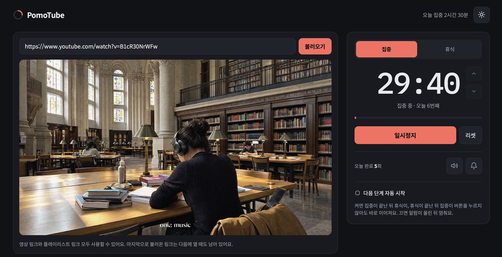

<div align="center">

# 🍅 PomoTube

**유튜브 영상을 보면서 뽀모도로 타이머를 한 화면에서.**

영상 링크를 붙여넣고, 집중 시간을 맞추고, 시작만 누르면 돼요.


</div>



---

## 소개

공부나 작업을 할 때 유튜브 영상(강의, 로파이 음악 등)을 틀어 두고 뽀모도로 타이머를 따로 켜는 게 번거로워서 만든 개인용 웹앱이에요. 영상과 타이머를 한 화면에 두고, 로그인이나 설치 없이 바로 쓸 수 있어요.

## 주요 기능

**영상**
- 유튜브 영상, 플레이리스트, 쇼츠, `youtu.be` 단축 링크를 붙여넣으면 바로 임베드돼요
- 마지막으로 불러온 링크는 다음에 열 때도 남아 있어요

**타이머**
- 집중 25분 / 휴식 5분이 기본이고, 1~180분 사이로 바꿀 수 있어요
- 시간 숫자를 클릭해서 직접 입력하거나 ▲▼ 버튼으로 1분씩 조절해요
- 다음 단계 자동 시작을 켜면 집중과 휴식이 버튼 없이 이어져요
- 탭 제목에 남은 시간이 표시돼서, 다른 탭을 보고 있어도 확인할 수 있어요
- 오늘 완료한 횟수와 집중한 시간을 보여 줘요

**알림**
- 끝나면 알람 소리가 울리고 브라우저 알림이 떠요
- 소리와 알림은 각각 버튼으로 끄고 켤 수 있어요

**화면**
- 다크 모드가 기본이고, 버튼으로 라이트 모드로 바꿀 수 있어요
- 데스크톱과 모바일 화면 모두 지원해요

## 기술 스택

| 구분 | 사용한 것 |
| --- | --- |
| 프레임워크 | Next.js 15 (App Router), React 19 |
| 언어 | TypeScript |
| 스타일 | CSS 변수 기반 순수 CSS (다크/라이트 테마) |
| 알람 소리 | Web Audio API (소리 파일 없이 코드로 생성) |
| 알림 | Notification API |
| 저장 | localStorage (서버 없음) |
| 배포 | Vercel |

외부 UI 라이브러리나 소리 파일 없이 만들었어요.

## 프로젝트 구조

```
pomo-tube
├── app
│   ├── layout.tsx     # 폰트, 저장된 테마 적용
│   ├── page.tsx       # 영상, 타이머, 알림 등 화면 전체
│   └── globals.css    # 다크/라이트 색상과 레이아웃
├── next.config.mjs
├── package.json
└── tsconfig.json
```

## 안내

- PomoTube는 YouTube와 관련 없는 비공식 개인 프로젝트예요. 영상은 YouTube의 공식 임베드 플레이어로 재생돼요.
- 영상 링크, 설정, 테마, 완료 횟수는 사용자 브라우저(localStorage)에만 저장돼요. 방문 수는 Vercel Web Analytics로 익명 집계돼요.
- 영상 주인이 임베드를 막아 둔 영상은 재생되지 않을 수 있어요.
- 알림은 PomoTube 탭이 열려 있는 동안에만 와요.

## 라이선스

[MIT](./LICENSE)
